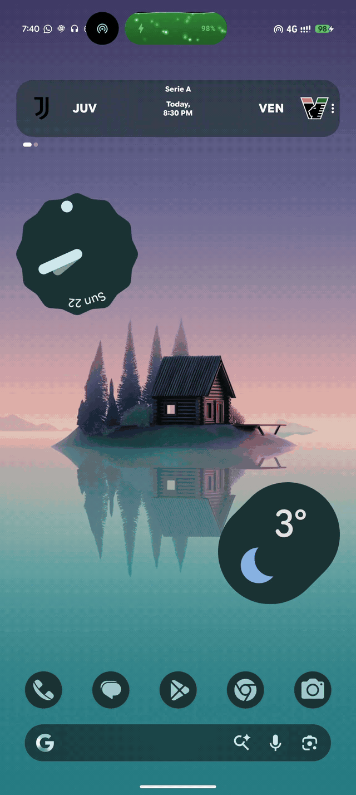
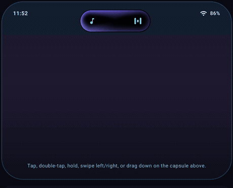
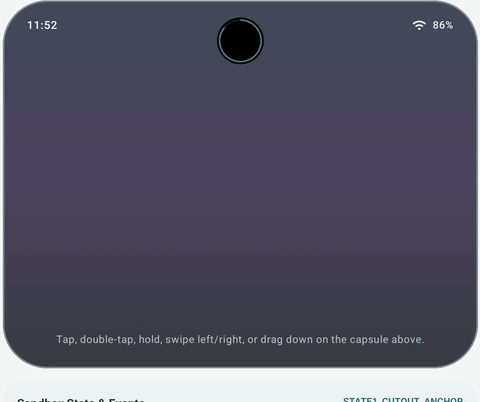
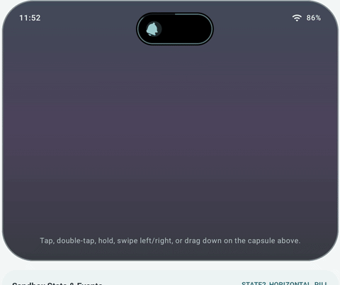
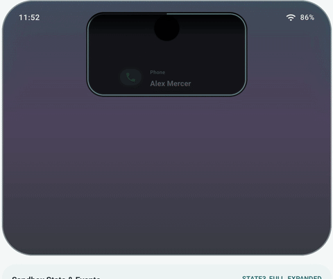
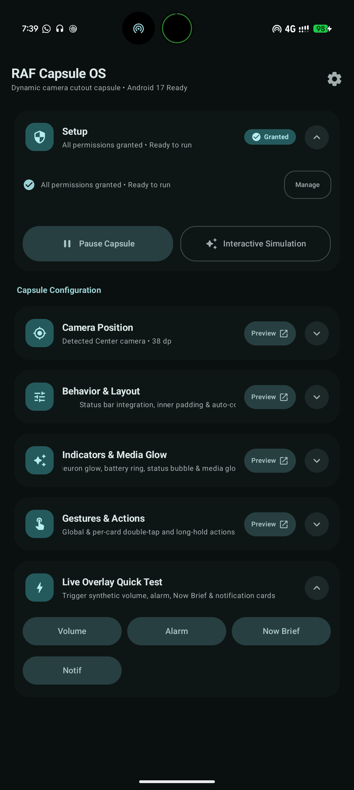
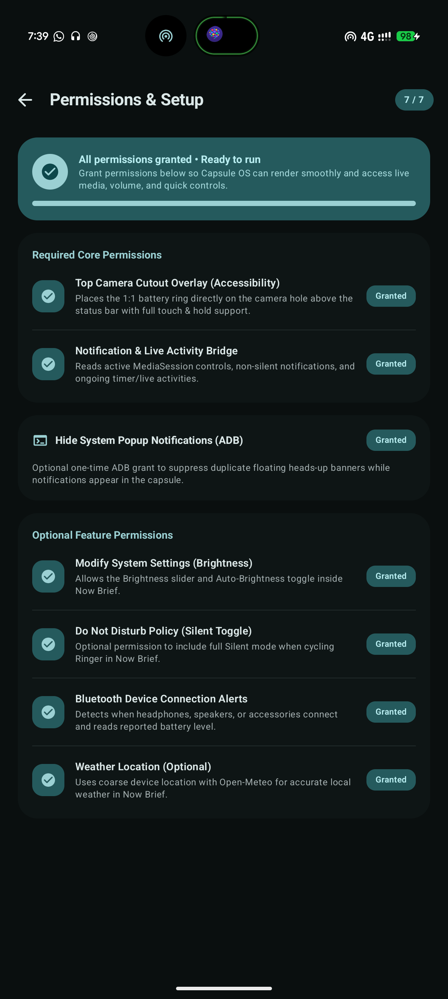
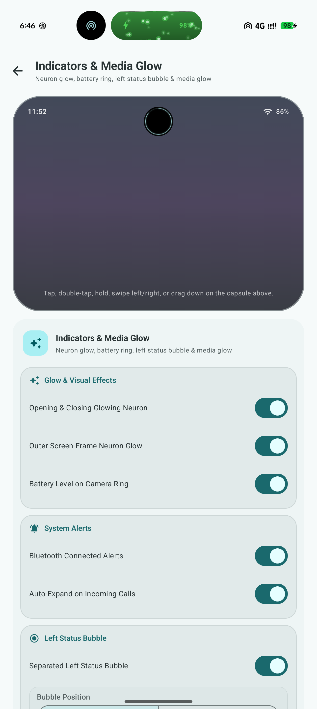
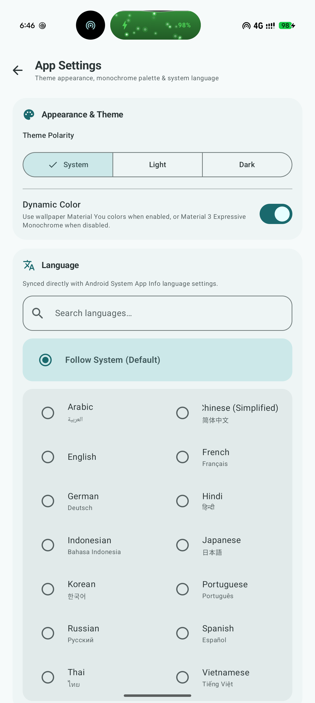

# RAF Capsule OS

<p align="center">
  <strong>🌐 Bahasa:</strong>
  <a href="README.md">English</a> •
  <a href="README-in.md"><strong>Bahasa Indonesia</strong></a> •
  <a href="README-ja.md">日本語</a> •
  <a href="README-ko.md">한국어</a> •
  <a href="README-zh.md">简体中文</a> •
  <a href="README-es.md">Español</a>
</p>

<p align="center">
  <strong>Kapsul Kamera Depan Dinamis &amp; Overlay Status Interaktif untuk Android 13–17</strong><br/>
  Dibangun dengan Kotlin 2.x • Jetpack Compose • Material 3 Expressive • Navigation 3 • Shader AGSL • Shizuku • Clean Architecture
</p>

<p align="center">
  
  
  
  
  
</p>

**RAF Capsule OS** mengubah lubang kamera depan ponsel Anda menjadi kapsul interaktif 1:1 yang menyatu dengan perangkat keras baik dalam mode **Potret maupun Lanskap**, ditenagai fisika pegas VSYNC, shader kilau neuron AGSL real-time, getaran haptik super halus, serta koordinator state Kotlin murni.

---

## Tampilan Visual

### Interaksi Kapsul Langsung (Direkam di Pixel 9 Pro)

<table>
  <tr>
    <td align="center" width="50%">
      <br/>
      <strong>Mode Lanskap (Pil Sisi Kamera &amp; Kartu Penuh)</strong>
    </td>
    <td align="center" width="50%">
      <br/>
      <strong>Pemutar Media, Jam Langsung &amp; Output Audio</strong>
    </td>
  </tr>
  <tr>
    <td align="center" width="50%">
      <br/>
      <strong>Lirik Tersinkronisasi Langsung (LRC)</strong>
    </td>
    <td align="center" width="50%">
      <br/>
      <strong>Gelembung Status Terpisah &amp; Liquid Morph</strong>
    </td>
  </tr>
  <tr>
    <td align="center" width="50%">
      <br/>
      <strong>Hub Cepat Now Brief</strong>
    </td>
    <td align="center" width="50%">
      <br/>
      <strong>Notifikasi Bulat &amp; Geser untuk Menghapus</strong>
    </td>
  </tr>
  <tr>
    <td align="center" width="50%">
      <br/>
      <strong>Panggilan Masuk &amp; Border Neuron</strong>
    </td>
    <td align="center" width="50%">
      <br/>
      <strong>Desain Baru Mixer Volume M3 Expressive</strong>
    </td>
  </tr>
</table>

### Layar Aplikasi & Pengaturan

<table>
  <tr>
    <td align="center" width="25%">
      <br/>
      <strong>Dasbor Utama</strong>
    </td>
    <td align="center" width="25%">
      <br/>
      <strong>Pusat Izin &amp; Shizuku</strong>
    </td>
    <td align="center" width="25%">
      <br/>
      <strong>Pratinjau Kamera Langsung</strong>
    </td>
    <td align="center" width="25%">
      <br/>
      <strong>Tema &amp; 14 Bahasa</strong>
    </td>
  </tr>
</table>

---

## Fitur Utama

- **Kapsul 3-Tahap (Potret & Lanskap)**: Cincin baterai 1:1 di sekitar kamera, pil ringkas (horizontal di Potret, vertikal di Lanskap), dan kartu buram yang diperluas dengan sudut melengkung konsentris yang dapat diatur (`0–56 dp` atau Deteksi Otomatis).
- **Mode Lanskap Penuh**: Mengikuti posisi kamera saat layar diputar dengan pil vertikal, gelembung status terpisah vertikal dengan indikator titik vertikal, kartu tinggi penuh (kecuali Senter), geser horizontal untuk buka/tutup, dan geser vertikal untuk ganti kartu.
- **Bilah Samping Kamera**: Menampilkan ikon + nama aplikasi di satu sisi kamera dan jam aktif (dengan detik) + tanggal lengkap yang dapat diketuk untuk membuka aplikasi Kalender di sisi lainnya.
- **Gelembung Status Terpisah**: Mendukung hingga 9 indikator sistem (Senter, Hotspot, Aktivitas Langsung, Mode Pesawat, Jangan Ganggu, Penghemat Baterai, VPN, Hening/Getar, Penghemat Data) dengan posisi yang dapat dikustomisasi.
- **Pemutar Media, Lirik LRC & Desain Baru Mixer Volume**: Carousel multi-sesi, lirik sinkron, tombol pindah output audio, serta mixer volume M3 Expressive dengan tombol bisu cepat, persentase langsung, slider haptik super halus, dan bilah Dering/Getar/Hening.
- **Pusat Izin Layar Penuh + Shizuku + Dukungan Xiaomi HyperOS**: Pemberian `WRITE_SECURE_SETTINGS` satu ketukan lewat **Shizuku** (tanpa PC), panduan **ADB** siap salin, serta perlindungan anti-crash & pintasan AutoStart/Baterai/Pop-up latar belakang khusus perangkat **Xiaomi / Redmi / POCO** (tanpa mengubah perilaku di Pixel).

---

## Instalasi & Izin

1. Unduh `app-release.apk` terbaru dari [GitHub Releases](https://github.com/RidhwanAF/RAF-Capsule/releases/latest) dan pasang via ADB (`adb install -r app-release.apk`) atau pengelola berkas.
2. Buka **RAF Capsule OS → Buka Pengaturan Izin**.
3. Aktifkan **Aksesibilitas** dan **Akses Notifikasi**.
4. Untuk menyembunyikan pop-up notifikasi sistem ganda (`WRITE_SECURE_SETTINGS`):
   - **Tanpa PC (Shizuku)**: Mulai [Shizuku](https://shizuku.rikka.app/) lewat Debugging Nirkabel, lalu ketuk **Berikan via Shizuku**.
   - **Dengan ADB**:
     ```bash
     adb shell pm grant com.raf.capsuleos android.permission.WRITE_SECURE_SETTINGS
     ```
5. *(Khusus Xiaomi / HyperOS)*: Aktifkan **AutoStart**, **Baterai: Tanpa Pembatasan**, dan **Jendela Pop-up Latar Belakang** melalui pintasan satu ketuk di layar Izin.
