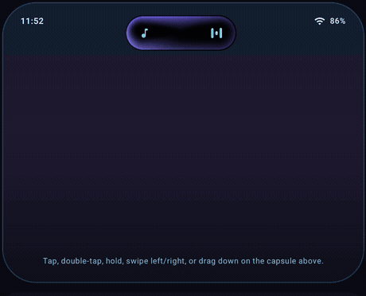
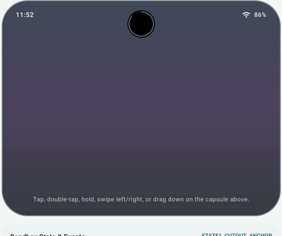

# RAF Capsule OS

<p align="center">
  <strong>🌐 言語:</strong>
  <a href="README.md">English</a> •
  <a href="README-in.md">Bahasa Indonesia</a> •
  <a href="README-ja.md"><strong>日本語</strong></a> •
  <a href="README-ko.md">한국어</a> •
  <a href="README-zh.md">简体中文</a> •
  <a href="README-es.md">Español</a>
</p>

<p align="center">
  <strong>Android 13–17向けダイナミックカメラカットアウト・カプセル＆インタラクティブオーバーレイ</strong><br/>
  Kotlin 2.x • Jetpack Compose • Material 3 Expressive • Navigation 3 • AGSLシェーダー • Shizuku • Clean Architecture
</p>

<p align="center">
  
  
  
  
</p>

**RAF Capsule OS** は、スマートフォンのフロントカメラ周囲を **縦画面・横画面の両方** で滑らかに動作するインタラクティブなカプセルUIへと進化させます。VSYNC同期のスプリング物理演算、AGSLニューロングローシェーダー、繊細な連続ハプティクス、純粋なKotlinステートコーディネーターを搭載しています。

---

## ビジュアルショーケース

<table>
  <tr>
    <td align="center" width="50%">
      <br/>
      <strong>メディアプレーヤー＆リアルタイム時計</strong>
    </td>
    <td align="center" width="50%">
      <br/>
      <strong>リアルタイム同期歌詞（LRC）</strong>
    </td>
  </tr>
  <tr>
    <td align="center" width="50%">
      <br/>
      <strong>独立ステータスバブル＆リキッドモーフ</strong>
    </td>
    <td align="center" width="50%">
      <br/>
      <strong>Now Brief クイックハブ</strong>
    </td>
  </tr>
  <tr>
    <td align="center" colspan="2">
      <br/>
      <strong>刷新されたM3 Expressive音量ミキサー</strong>
    </td>
  </tr>
</table>

### 横画面モード機能

| 機能 | 横画面での動作 |
|---|---|
| **サイドベゼル縦型ピル** | 回転したカメラ位置に追従し、縦向きのコンパクトピルとして表示 |
| **縦型ステータスバブル** | 縦ドットインジケーターと縦スワイプ切替に対応した独立バブル |
| **フルハイト展開カード** | 均等パディング・横方向ブラーグラデーション・ライト用正方形例外に対応 |
| **横画面専用ジェスチャー** | 横スワイプで開閉、縦スワイプでカードやメディアセッションを切替 |
| **カメラ横ライブバー** | アプリアイコン＋名前、秒表示付き時計、カレンダー起動付き日付を表示 |

---

## 主な機能

- **3段階ダイナミックカプセル（縦・横両対応）**: カメラ周囲のバッテリーリング、コンパクトピル（縦画面は横長・横画面は縦長）、角丸半径をカスタマイズ可能なフロストブラー展開カード（`0–56 dp` / 自動検出）。
- **完全横画面モード**: 回転したカメラ位置に追従し、縦型ピル、縦型ステータスバブル＆縦ドットインジケーター、フルハイトカード、横スワイプ開閉・縦スワイプ切替に対応。
- **カメラ横ライブバー**: 展開カード上部でアプリアイコン＋名前、秒表示付き時計、カレンダーアプリを起動できる日付表示を無駄なく配置。
- **独立ステータスバブル**: ライト、テザリング、ライブアクティビティ、機内モード、サイレント、バッテリーセーバー、VPN、マナー/バイブ、データセーバーの9種に対応。
- **メディアプレーヤー＆新音量ミキサー**: マルチセッション切替、LRC同期歌詞、オーディオ出力切替、ワンタップミュート＆パーセント表示付きフロスト音量ミキサー。
- **フルスクリーン権限ハブ＋Shizuku＋Xiaomi HyperOS対応**: PC不要の **Shizuku** ワンタップ権限付与、ADB手順コピー、さらにXiaomi/Redmi/POCO端末専用のクラッシュ保護と自動起動・バッテリー制限解除ショートカット（Pixel動作には一切影響なし）。

---

## インストールと権限設定

1. [GitHub Releases](https://github.com/RidhwanAF/RAF-Capsule/releases/latest) から最新の `app-release.apk` をダウンロードしてインストールします（`adb install -r app-release.apk` 推奨）。
2. アプリ内の **権限とセットアップ** 画面から「ユーザー補助」と「通知アクセス」を許可します。
3. システムの重複ヘッドアップ通知を非表示にする `WRITE_SECURE_SETTINGS` の付与：
   - **Shizuku（PC不要）**: [Shizuku](https://shizuku.rikka.app/) をワイヤレスデバッグで起動し、アプリ内で **Shizukuで付与** をタップ。
   - **ADB**:
     ```bash
     adb shell pm grant com.raf.capsuleos android.permission.WRITE_SECURE_SETTINGS
     ```
