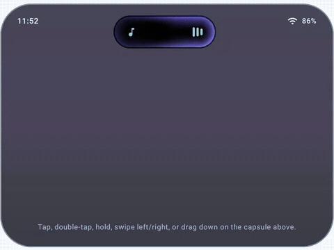
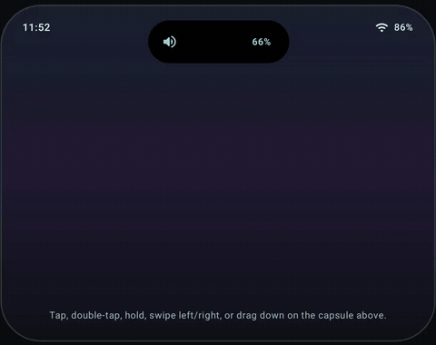

# RAF Capsule OS

<p align="center">
  <strong>🌐 언어:</strong>
  <a href="README.md">English</a> •
  <a href="README-in.md">Bahasa Indonesia</a> •
  <a href="README-ja.md">日本語</a> •
  <a href="README-ko.md"><strong>한국어</strong></a> •
  <a href="README-zh.md">简体中文</a> •
  <a href="README-es.md">Español</a>
</p>

<p align="center">
  <strong>Android 13–17용 다이내믹 카메라 컷아웃 캡슐 &amp; 인터랙티브 오버레이</strong><br/>
  Kotlin 2.x • Jetpack Compose • Material 3 Expressive • Navigation 3 • AGSL 셰이더 • Shizuku • Clean Architecture
</p>

<p align="center">
  
  
  
  
</p>

**RAF Capsule OS**는 스마트폰 전면 카메라 컷아웃을 **세로 및 가로 모드 모두**에서 부드럽게 동작하는 1:1 하드웨어 정렬 인터랙티브 캡슐로 변환합니다. VSYNC 스프링 물리 엔진, AGSL 뉴런 글로우 셰이더, 초미세 연속 햅틱 피드백, 순수 Kotlin 상태 코디네이터를 기반으로 구축되었습니다.

---

## 비주얼 쇼케이스

<table>
  <tr>
    <td align="center" width="50%">
      <br/>
      <strong>미디어 플레이어 &amp; 실시간 시계</strong>
    </td>
    <td align="center" width="50%">
      <br/>
      <strong>분리된 상태 버블 &amp; 리퀴드 모프</strong>
    </td>
  </tr>
  <tr>
    <td align="center" colspan="2">
      <br/>
      <strong>새로워진 M3 Expressive 볼륨 믹서</strong>
    </td>
  </tr>
</table>

### 가로 모드 기능

| 기능 | 가로 모드 동작 |
|---|---|
| **측면 베젤 수직 필** | 회전된 카메라 위치에 맞춰 수직 콤팩트 필로 표시 |
| **수직 상태 버블** | 수직 도트 인디케이터 및 세로 스와이프 전환 지원 |
| **풀하이트 확장 카드** | 대칭 여백, 가로 블러 그라데이션 및 손전등 정사각형 예외 적용 |
| **자연스러운 가로 제스처** | 가로 스와이프로 열기/닫기, 세로 스와이프로 카드 및 미디어 전환 |
| **카메라 양옆 라이브 바** | 앱 아이콘/이름 및 초 단위 시계 + 캘린더 바로가기 날짜 표시 |

---

## 주요 기능

- **3단계 다이내믹 캡슐 (세로 & 가로)**: 카메라 배터리 링, 콤팩트 필(세로=가로형 / 가로=세로형), 모서리 둥글기(`0–56 dp` 또는 자동 감지)를 지원하는 블러 확장 카드.
- **완벽한 가로 모드**: 회전된 카메라 측면에 맞춰 수직 필, 수직 상태 버블 및 수직 도트 인디케이터, 전체 높이 카드, 가로 스와이프 열기/닫기 및 세로 스와이프 전환 지원.
- **카메라 양옆 라이브 바**: 확장 카드 상단 빈 공간에 앱 아이콘+이름, 초 단위 시계, 캘린더 앱을 바로 여는 날짜 표시 배치.
- **분리된 상태 버블**: 손전등, 핫스팟, 실시간 활동, 비행기 모드, 방해 금지, 배터리 절약, VPN, 무음/진동, 데이터 절약 등 최대 9개 지표 표시.
- **비트 반응형 오디오 비주얼라이저 (서드파티 라이브러리 제로)**: Android 기본 `Visualizer` (`audioSessionId = 0`), `AudioManager.getStreamVolumeDb` 보정이 적용된 32비트 `MEASUREMENT_MODE_PEAK_RMS`, 순수 Kotlin 3밴드 FFT 분석(`bass`, `mid`, `high`, `beatPulse`)으로 잔잔한 곡은 부드럽게, 강한 비트는 역동적으로 반응합니다. **확장 미디어 카드(State 3)**(AGSL 웨이브 배경, 뉴런 테두리, 화면 외곽 오라, 깔끔한 앨범 프레임, 회전하는 M3 쿠키)와 **콤팩트 화면(State 2 / State 1)**(`가로 필`, `카메라 링`, `앨범 카드`, 실시간 3밴드 EQ 바) 모두 음악에 맞춰 동기화됩니다.
- **미디어 플레이어, LRC 가사 & 볼륨 믹서**: 다중 미디어 세션, 실시간 가사, 오디오 출력 전환, 탭 음소거 및 퍼센트 표시가 적용된 M3 Expressive 볼륨 믹서.
- **전용 권한 허브 + Shizuku + Xiaomi HyperOS 호환성**: PC 없이 **Shizuku**로 원탭 `WRITE_SECURE_SETTINGS` 부여, ADB 명령어 복사, Xiaomi/Redmi/POCO 전용 백그라운드 보호 및 충돌 방지 가드(Pixel 동작 변경 없음).

---

## 설치 및 권한

1. [GitHub Releases](https://github.com/RidhwanAF/RAF-Capsule/releases/latest)에서 최신 `app-release.apk`를 다운로드해 설치합니다 (`adb install -r app-release.apk` 권장).
2. 앱 내 **권한 및 설정** 화면에서 **접근성**과 **알림 접근**을 허용합니다.
3. `WRITE_SECURE_SETTINGS`(중복 시스템 헤드업 알림 숨김) 및 `RECORD_AUDIO`(비트 반응형 비주얼라이저) 부여:
   - **Shizuku (PC 불필요)**: 무선 디버깅으로 [Shizuku](https://shizuku.rikka.app/) 실행 후 **Shizuku로 허용** 탭.
   - **ADB**:
     ```bash
     adb shell pm grant com.raf.capsuleos android.permission.WRITE_SECURE_SETTINGS
     adb shell pm grant com.raf.capsuleos android.permission.RECORD_AUDIO
     adb shell appops set com.raf.capsuleos RECORD_AUDIO allow
     adb shell appops set com.raf.capsuleos SYSTEM_ALERT_WINDOW allow
     ```

---

### 앱 삭제 전 Android 기본 설정 복구 (ADB)

RAF Capsule OS는 활성화 시 캡슐에 알림을 깔끔하게 표시하기 위해 시스템 기본 플로팅 헤드업 알림 팝업(`heads_up_notifications_enabled = 0`)을 숨길 수 있습니다. 앱을 삭제하기 전(또는 삭제 후에도 시스템 알림 팝업이 다시 나타나지 않는 경우) 아래 ADB 명령어를 실행해 Android 기본값을 복구하세요:

```bash
# 시스템 기본 헤드업 알림 팝업 다시 활성화
adb shell settings put global heads_up_notifications_enabled 1

# (선택 사항) 상태 표시줄 아이콘 숨김 설정을 변경했던 경우 초기화
adb shell settings delete secure icon_blacklist
```

*(팁: 앱을 삭제하기 전에 앱 내 **시스템 헤드업 알림 숨기기**를 끄거나 접근성 서비스를 일시 중지/해제하면 자동으로 복구됩니다.)*
