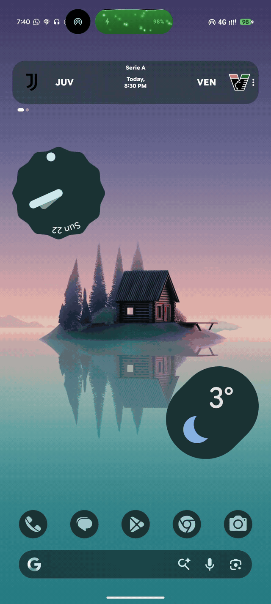
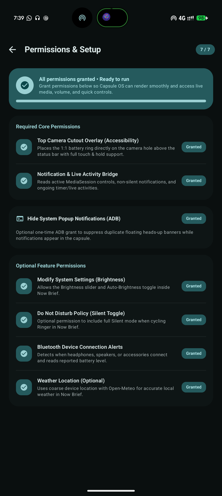

# RAF Capsule OS

<p align="center">
  <strong>🌐 Language:</strong>
  <a href="README.md"><strong>English</strong></a> •
  <a href="README-in.md">Bahasa Indonesia</a> •
  <a href="README-ja.md">日本語</a> •
  <a href="README-ko.md">한국어</a> •
  <a href="README-zh.md">简体中文</a> •
  <a href="README-es.md">Español</a>
</p>

<p align="center">
  <strong>Dynamic Camera Cutout Capsule &amp; Interactive Status Overlay for Android 13–17</strong><br/>
  Built with Kotlin 2.x • Jetpack Compose • Material 3 Expressive • Navigation 3 • AGSL Shaders • Shizuku • Clean Architecture
</p>

<p align="center">
  
  
  
  
  
</p>

<p align="center">
  <a href="#visual-showcase">Visual Showcase</a> •
  <a href="#core-features">Core Features</a> •
  <a href="#installation">Installation</a> •
  <a href="#step-3--grant-permissions">Permissions, Shizuku &amp; ADB</a> •
  <a href="https://github.com/RidhwanAF/RAF-Capsule/releases/latest">Download APK</a> •
  <a href="#architecture">Architecture</a>
</p>

**RAF Capsule OS** transforms your phone's front camera cutout into a fluid, 1:1 hardware-aligned interactive capsule in both **Portrait and Landscape** orientations, powered by VSYNC-coupled spring physics, real-time AGSL neuron glow shaders, whisper-light continuous haptics, and a pure-Kotlin state coordinator. It includes an isolated **Interactive Simulation** sandbox powered by the exact same pixel-level VSYNC spring solver (`CapsuleSpringAxis` + deferred layout pass) so every gesture, scrub-to-coast velocity handoff, glow effect, and notification layout runs identically to the live overlay without touching system settings.

---

## Visual Showcase

### Live Capsule Interactions (Recorded on Pixel 9 Pro)

<table>
  <tr>
    <td align="center" width="50%">
      <br/>
      <strong>Landscape Mode (Side-Bezel Pill &amp; Full-Height Cards)</strong>
    </td>
    <td align="center" width="50%">
      <br/>
      <strong>Media Player, Live Clock &amp; Audio Switcher</strong>
    </td>
  </tr>
  <tr>
    <td align="center" width="50%">
      <br/>
      <strong>Live Synced Lyrics (LRC &amp; Online Fetch)</strong>
    </td>
    <td align="center" width="50%">
      <br/>
      <strong>Separated Status Bubble &amp; Liquid Morph</strong>
    </td>
  </tr>
  <tr>
    <td align="center" width="50%">
      <br/>
      <strong>Now Brief Quick Hub</strong>
    </td>
    <td align="center" width="50%">
      <br/>
      <strong>Rounded Notifications &amp; Swipe-to-Dismiss</strong>
    </td>
  </tr>
  <tr>
    <td align="center" width="50%">
      <br/>
      <strong>Incoming Call Auto-Expand &amp; Neuron Border</strong>
    </td>
    <td align="center" width="50%">
      <br/>
      <strong>Redesigned M3 Expressive Volume Mixer</strong>
    </td>
  </tr>
</table>

### App Screens & Configuration

<table>
  <tr>
    <td align="center" width="25%">
      <br/>
      <strong>Home Dashboard</strong>
    </td>
    <td align="center" width="25%">
      <br/>
      <strong>Permissions &amp; Shizuku Hub</strong>
    </td>
    <td align="center" width="25%">
      <br/>
      <strong>Live Cutout Preview</strong>
    </td>
    <td align="center" width="25%">
      <br/>
      <strong>Theme &amp; 14 Languages</strong>
    </td>
  </tr>
</table>

> **Tip:** Open [`CapsuleShowcasePreviews.kt`](presentation/src/main/kotlin/com/raf/capsuleos/presentation/preview/CapsuleShowcasePreviews.kt) in Android Studio to inspect live Jetpack Compose `@Preview` screens and capsule states directly in the editor.

---

## Core Features

### 3-State Dynamic Cutout Capsule (Portrait & Landscape)
- **State 1 — Cutout Anchor Ring**: 1:1 hardware camera cutout ring with clockwise battery-level progress arc, charging particles, and automatic cutout calibration (`Left`, `Center`, `Right` + fine `dp` offset tuning).
- **State 2 — Compact Pill (Horizontal in Portrait, Vertical in Landscape)**: Asymmetric pill for active media, notifications, volume, charging, timers, Bluetooth connections, and periodic 1-minute notification summaries.
- **State 3 — Frosted Expanded Card**: Concentric display-corner rounded card (with customizable expanded corner roundness `0–56 dp` or hardware Auto-Detect), behind-window blur gradient, VSYNC spring physics, and 1:1 finger-tracked scrub-to-expand/collapse.
- **Full Landscape Mode**: Optional toggle that anchors the capsule to the rotated camera bezel with a vertical compact pill, vertical separated status bubble with vertical page dots, full-height expanded cards (except Flashlight's compact square), horizontal expand/collapse gestures, vertical card/session swiping, and rotation-aware camera-flanking top bar.
- **Camera-Flanking Live Bar**: Uses the space beside the camera cutout in State 3 to show the active app/feature icon + name on the start flank and a live ticking clock (with seconds) + clickable full date with Calendar shortcut on the end flank.
- **AGSL Shaders**: Hardware-accelerated [`NeuralBorderShader`](presentation/src/main/kotlin/com/raf/capsuleos/presentation/shader/NeuralBorderShader.kt) and [`OuterExpansionAuraShader`](presentation/src/main/kotlin/com/raf/capsuleos/presentation/shader/OuterExpansionAuraShader.kt) adapted for both Portrait and Landscape edges.

### Separated Status Bubble (Customizable Position)
- Displays up to **9 active system indicators** in an independent circular satellite bubble next to the main capsule (customizable **Left / Right** in Portrait, mapped cleanly to **Bottom / Top** in Landscape):
  - Flashlight, Mobile Hotspot, Live Activity / Timer, Airplane Mode, Do Not Disturb, Battery Saver, VPN, Silent / Vibrate, and Data Saver.
- Swipe across the bubble (or swipe inside its expanded card) to cycle active indicators, or tap to smoothly merge and expand directly into its control card.

### Media Player, Live Lyrics & Redesigned Volume Mixer
- **Multi-Session Media Carousel**: Horizontal pager in Portrait and edge-to-edge vertical pager in Landscape with album-art color extraction, animated waveform visualizer, centered landscape layout that smoothly glides upward when synced lyrics open, and Audio Output Switcher.
- **Synced Lyrics (`LRC`)**: Toggleable line-by-line lyrics synced to playback position when supported by the active media session or fetched online via LRCLIB.
- **Redesigned Volume Mixer**: Frosted M3 Expressive stream tiles (Media, Ring, Alarm, Call, Notification) with tap-to-mute icon badges, live percentage readouts, whisper-light continuous-haptic sliders, and a full-width segmented Ring / Vibrate / Silent control bar.

### Messaging, Now Brief, Gestures & OEM Stability
- **Smart Notifications**: Dynamic tall card with inline photos/GIFs/WebP stickers, directional scroll gradients, inline Quick Reply (`RemoteInput`), and elastic swipe-to-dismiss.
- **Now Brief Quick Hub**: Live weather, battery/charging wave fill, next alarm, flashlight toggle, volume/ringer controls, adaptive brightness slider, lock screen button, and tap-to-open notification shade — optimized cleanly into a single-column Bento layout in Landscape.
- **Per-Card Gestures & Whisper-Light Haptics**: Configure global and per-card Double-Tap and Long-Hold actions, paired with ultra-gentle continuous waveform haptics for sliders and scrubbing.
- **Dedicated Permissions Hub + Shizuku + Xiaomi HyperOS Support**: Full-screen Permissions screen with one-tap **Shizuku** `WRITE_SECURE_SETTINGS` granting, step-by-step **ADB** copy card, and Xiaomi/Redmi/POCO-only MIUI/HyperOS crash guards & AutoStart/Battery/Background-Popup shortcuts (zero behavioral changes on Pixel devices).
- **Material 3 Expressive & 14 Languages**: Dynamic Color or Monochrome themes (`System`, `Light`, `Dark`) and searchable per-app localization across 14 languages synced with Android System App Info.

---

## Installation

### Prerequisites
- **Android 13+ (API 33–37)** device (tested on Pixel 9 Pro / Android 17).
- **JDK 21** and **Android SDK Platform-Tools (`adb`)** (if building from source).

---

### Step 1 — Get the APK (Download Pre-built or Build from Source)

- **Fastest: Download Pre-built Signed Release APK**
  Grab the latest `app-release.apk` directly from [GitHub Releases](https://github.com/RidhwanAF/RAF-Capsule/releases/latest) and jump straight to [Step 2](#step-2--install-the-apk-on-your-device).

- **Or Build from Source**:
  1. Clone the repository:
     ```bash
     git clone https://github.com/RidhwanAF/RAF-Capsule.git
     cd RAF-Capsule
     ```
  2. Build Debug (no keystore required) or signed Release:
     ```bash
     # Debug APK (auto-signed with debug.keystore)
     ./gradlew assembleDebug

     # Release APK (requires signing keys in local.properties)
     ./gradlew :domain:test lintDebug assembleRelease
     ```

---

### Step 2 — Install the APK on Your Device

#### Method A: Install via ADB (Recommended)
```bash
adb install -r app/build/outputs/apk/release/app-release.apk
```
*(Installing via `adb install` automatically bypasses Android 13+ Restricted Settings blocks for Accessibility & Notification Access.)*

#### Method B: Install via Phone File Manager (Sideload APK)
1. Tap the `.apk` file in **Files** and allow **Install unknown apps**.
2. Open **Settings → Apps → RAF Capsule OS → ⋮ → Allow restricted settings** to unlock Accessibility and Notification Listener toggles.

---

### Step 3 — Grant Permissions

Open **RAF Capsule OS** and tap **Open Permission Setup** (or **Manage**) to open the dedicated full-screen **Permissions & Setup** hub:

| Permission / Service | Purpose | Required? | Grant Method |
|---|---|---|---|
| **Accessibility Overlay** (`CapsuleAccessibilityService`) | Renders the `TYPE_ACCESSIBILITY_OVERLAY` capsule above the status bar & lock screen | **Required** | In-app Permissions Hub or ADB |
| **Notification & Media Listener** (`CapsuleNotificationListenerService`) | Reads active `MediaSession` tracks, notifications, inline attachments & live activities | **Required** | In-app Permissions Hub or ADB |
| **`WRITE_SECURE_SETTINGS`** | Suppresses duplicate system heads-up popup banners while notifications appear in the capsule | Optional (Recommended) | **Shizuku (1-Tap, No PC)** or **ADB** |
| **`WRITE_SETTINGS`** | Enables Brightness slider & Adaptive Brightness toggle in Now Brief | Optional | In-app Permissions Hub or ADB |
| **Do Not Disturb Policy** | Allows cycling into full Silent mode from Now Brief & Volume Mixer | Optional | In-app Permissions Hub or ADB |
| **`BLUETOOTH_CONNECT`** | Detects connected Bluetooth headphones/accessories & battery level | Optional | In-app Permissions Hub or ADB |
| **`ACCESS_COARSE_LOCATION`** | Uses coarse location with Open-Meteo for local weather in Now Brief | Optional | In-app Permissions Hub or ADB |
| **Xiaomi / HyperOS AutoStart & Battery** *(Xiaomi/Redmi/POCO only)* | Prevents MIUI/HyperOS from stopping the Accessibility overlay in the background | Xiaomi Only | One-tap shortcuts in Permissions Hub |

#### Option 1: Grant `WRITE_SECURE_SETTINGS` in One Tap via Shizuku (No PC)
1. Install and start [Shizuku](https://shizuku.rikka.app/) via Android **Wireless Debugging**.
2. In **RAF Capsule OS → Permissions & Setup**, tap **Authorize Shizuku** → **Grant via Shizuku**.

#### Option 2: Grant via ADB Command
```bash
adb shell pm grant com.raf.capsuleos android.permission.WRITE_SECURE_SETTINGS
```

---

## Architecture

RAF Capsule OS follows strict multi-module **Clean Architecture + MVVM**:

```text
CapsuleOS/
├── app/            # Application entry point, MainActivity, Hilt root, ShizukuProvider & manifest
├── domain/         # Pure Kotlin business logic (zero android.* dependencies)
│   ├── coordinator/  # IslandStateCoordinator priority stack, timers & gesture state machine
│   ├── model/        # CapsuleUiState, CapsuleContent, CapsuleEvent, CapsulePreferences, LrcLyricsParser
│   └── repository/   # Pure repository interfaces
├── data/           # Android platform implementations & Hilt bindings
│   ├── hardware/     # Torch, Volume, Brightness, Bluetooth repositories
│   ├── media/        # CapsuleNotificationListenerService & MediaSessionRepositoryImpl
│   ├── settings/     # DataStore Preferences persistence
│   ├── statusbar/    # StatusBarIconControllerImpl (heads-up suppression via WRITE_SECURE_SETTINGS)
│   └── system/       # SystemEventsRepositoryImpl (Battery, Calls, Hotspot, Weather, System toggles)
└── presentation/   # Jetpack Compose UI, Navigation 3, AGSL Shaders & Accessibility Overlay host
    ├── capsule/      # CapsuleAccessibilityService, CapsuleOverlayController, Portrait & Landscape cards
    ├── permissions/  # Full-screen PermissionsScreen with Shizuku, ADB & Xiaomi HyperOS shortcuts
    ├── shader/       # NeuralBorderShader & OuterExpansionAuraShader (AGSL)
    ├── setup/        # Home Dashboard & modular M3 Expressive configuration cards
    ├── customization/# Dedicated section screens with real-time interactive mockup
    ├── simulation/   # Isolated interactive sandbox (SimulationViewModel & CapsulePhoneMockup)
    ├── appsettings/  # Theme polarity, Dynamic Color / Monochrome & 14-language selector
    └── preview/      # Jetpack Compose @Preview showcase definitions
```

### Verification Commands

```bash
./gradlew :domain:test
./gradlew lintDebug
./gradlew assembleRelease
```
