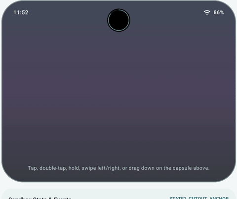
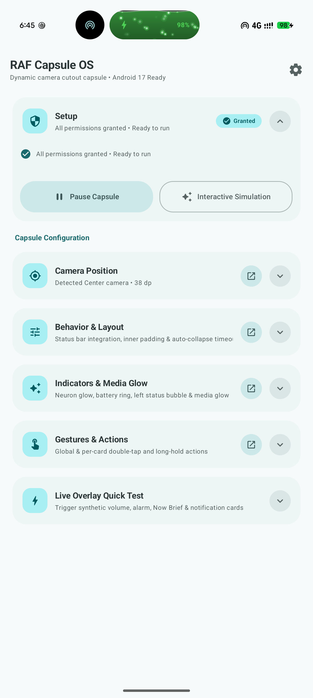

# RAF Capsule OS

<p align="center">
  <strong>Dynamic Camera Cutout Capsule &amp; Interactive Status Overlay for Android 13–17</strong><br/>
  Built with Kotlin 2.x • Jetpack Compose • Material 3 Expressive • Navigation 3 • AGSL Shaders • Clean Architecture
</p>

<p align="center">
  
  
  
  
  
</p>

<p align="center">
  <a href="#visual-showcase">Visual Showcase</a> •
  <a href="#core-features">Core Features</a> •
  <a href="#installation">Installation</a> •
  <a href="#step-3--grant-permissions">Permissions &amp; ADB</a> •
  <a href="https://github.com/RidhwanAF/RAF-Capsule/releases/latest">Download APK</a> •
  <a href="#architecture">Architecture</a>
</p>

**RAF Capsule OS** transforms your phone's front camera cutout into a fluid, 1:1 hardware-aligned interactive capsule powered by VSYNC-coupled spring physics, real-time AGSL neuron glow shaders, and a pure-Kotlin state coordinator. It includes an isolated **Interactive Simulation** sandbox powered by the exact same pixel-level VSYNC spring solver (`CapsuleSpringAxis` + deferred layout pass) so every gesture, scrub-to-coast velocity handoff, glow effect, and notification layout runs identically to the live overlay without touching system settings.

---

## Visual Showcase

### Live Capsule Interactions (Recorded on Pixel 9 Pro Simulation)

<table>
  <tr>
    <td align="center" width="50%">
      <br/>
      <strong>Media Player, Visualizer &amp; Audio Switcher</strong>
    </td>
    <td align="center" width="50%">
      <br/>
      <strong>Live Synced Lyrics (LRC &amp; Online Fetch)</strong>
    </td>
  </tr>
  <tr>
    <td align="center" width="50%">
      <br/>
      <strong>Separated Status Bubble &amp; Liquid Morph</strong>
    </td>
    <td align="center" width="50%">
      <br/>
      <strong>Rounded Notifications &amp; Swipe-to-Dismiss</strong>
    </td>
  </tr>
  <tr>
    <td align="center" width="50%">
      <br/>
      <strong>Now Brief Quick Hub</strong>
    </td>
    <td align="center" width="50%">
      <br/>
      <strong>Incoming Call Auto-Expand &amp; Neuron Border</strong>
    </td>
  </tr>
</table>

### App Screens & Configuration

<table>
  <tr>
    <td align="center" width="33%">
      <br/>
      <strong>Home Dashboard &amp; Live Overlay</strong>
    </td>
    <td align="center" width="33%">
      <br/>
      <strong>Live Customization &amp; Cutout Preview</strong>
    </td>
    <td align="center" width="33%">
      <br/>
      <strong>Dynamic Theme &amp; 14 Languages</strong>
    </td>
  </tr>
</table>

> **Tip:** Open [`CapsuleShowcasePreviews.kt`](presentation/src/main/kotlin/com/raf/capsuleos/presentation/preview/CapsuleShowcasePreviews.kt) in Android Studio to inspect all 8 live Jetpack Compose `@Preview` screens and capsule states directly in the editor.

---

## Core Features

### 3-State Dynamic Cutout Capsule
- **State 1 — Cutout Anchor Ring**: 1:1 hardware camera cutout ring with clockwise battery-level progress arc, charging particles, and automatic cutout calibration (`Left`, `Center`, `Right` + fine `dp` offset tuning).
- **State 2 — Horizontal Pill**: Compact asymmetric pill for active media, notifications, volume, charging, timers, Bluetooth connections, and periodic 1-minute notification summaries (visible for 3 seconds with a 1-second bell jiggle).
- **State 3 — Frosted Expanded Card**: Concentric display-corner rounded card with behind-window vertical blur, VSYNC spring physics, and 1:1 finger-tracked vertical scrub-to-expand/collapse.
- **AGSL Shaders**: Hardware-accelerated [`NeuralBorderShader`](presentation/src/main/kotlin/com/raf/capsuleos/presentation/shader/NeuralBorderShader.kt) and [`OuterExpansionAuraShader`](presentation/src/main/kotlin/com/raf/capsuleos/presentation/shader/OuterExpansionAuraShader.kt) with independent toggles for inner card glow, outer screen-frame glow, and persistent playback aura.

### Separated Status Bubble (Left or Right)
- Displays up to **9 active system indicators** in an independent circular satellite bubble next to the main capsule (customizable **Left** or **Right** placement, defaulting to **Left**):
  - Flashlight, Mobile Hotspot, Live Activity / Timer, Airplane Mode, Do Not Disturb, Battery Saver, VPN, Silent / Vibrate, and Data Saver.
- Swipe horizontally on the bubble to cycle active indicators (with dot pagination when 2+ states are active), or tap to smoothly merge and expand directly into its control card.

### Media Player & Live Audio
- Multi-session media carousel with album-art color extraction, animated waveform visualizer, and seekable timeline.
- **Synced Lyrics (`LRC`)**: Toggleable line-by-line lyrics synced to playback position when supported by the active media session or fetched online via LRCLIB.
- **Audio Output Switcher**: Launches Android's native blurred SystemUI volume/output panel directly from the expanded media card.
- **Independent Media Customization**: Multi-select expanded animations (`Card Border`, `Outer Frame`, `Album Card`), **Animation Color** selector (`Album Color` default or `Primary Color`), separate horizontal-pill glow style, and dedicated auto-collapse timeout (`10s–60s` or follow global).

### Messaging & Smart Notifications
- **Dynamic Tall Card & Inline Media**: Long messages automatically expand taller (~5–10 lines) and decode inline photos, animated GIFs, and animated WebP stickers natively via `ImageDecoder` / `AnimatedImageDrawable`.
- **Directional Scroll Indicators**: Top and bottom horizontal primary hairlines with inward primary-to-transparent gradients appear only when scrollable in that direction.
- **Inline Quick Reply & Swipe-to-Dismiss**: Reply inline via `RemoteInput`, or swipe horizontally left/right across the expanded notification card for an elastic rubber-band jiggle and smooth dismissal back into the camera cutout.

### Now Brief, System Alerts & Gestures
- **Now Brief Quick Hub**: Swipe down or long-hold the idle ring for live weather, battery, next alarm, flashlight toggle, volume/ringer controls, adaptive brightness slider, lock screen button, and tap-to-open notification shade.
- **Lock Screen & Quick Settings Integration**: Independently configure **Show on Lock Screen** and **Hide on QS Open** (collapsing cleanly to the non-touchable battery camera ring with zero unlock bounce).
- **Per-Card Gestures**: Configure global and per-card (`Idle Ring`, `Media`, `Flashlight`, `Notification`, `Volume`) Double-Tap and Long-Hold actions, including launching any installed app.
- **Material 3 Expressive & 14 Languages**: Dynamic Color or Monochrome themes (`System`, `Light`, `Dark`), tactile `HapticFeedbackType` feedback, adaptive multi-column `FlowRow` layouts, and searchable per-app localization across 14 languages synced with Android System App Info.

---

## Installation

### Prerequisites
- **Android 13+ (API 33–37)** device (tested on Pixel 9 Pro / Android 17).
- **JDK 21** and **Android SDK Platform-Tools (`adb`)** (required for building from source and ADB installation/permissions).

---

### Step 1 — Get the APK (Download Pre-built or Build from Source)

- **Fastest: Download Pre-built Signed Release APK**
  Grab the latest `app-release.apk` directly from [GitHub Releases](https://github.com/RidhwanAF/RAF-Capsule/releases/latest) and jump straight to [Step 2](#step-2--install-the-apk-on-your-device).

- **Or Build from Source**:
  1. Clone the repository:
     ```bash
     git clone https://github.com/RidhwanAF/RAF-Capsule.git
     cd RAF-Capsule
     ```

  2. Choose **Debug** (no keystore needed) or **Release** (requires your own signing keystore):

   - **Option A: Debug Build (Recommended for testing — no keystore required)**
     Android Gradle automatically signs debug builds using your local `~/.android/debug.keystore`:
     ```bash
     ./gradlew assembleDebug
     # Output: app/build/outputs/apk/debug/app-debug.apk
     ```

   - **Option B: Release Build (Minified R8 APK — requires your own `.jks` keystore)**
     For security, `local.properties` and `*.jks` / `*.keystore` files are excluded from Git. Without signing credentials, `./gradlew assembleRelease` produces an **unsigned** APK (`app-release-unsigned.apk`) that Android will refuse to install.

     To build a signed release APK:
     1. Generate a keystore if you do not have one:
        ```bash
        keytool -genkeypair -v -keystore capsule-release.jks -alias capsule -keyalg RSA -keysize 2048 -validity 10000
        ```
     2. Add your keystore path and credentials to `local.properties` in the project root:
        ```properties
        RELEASE_STORE_FILE=/absolute/path/to/capsule-release.jks
        RELEASE_STORE_PASSWORD=your_store_password
        RELEASE_KEY_ALIAS=capsule
        RELEASE_KEY_PASSWORD=your_key_password
        ```
     3. Build the signed release APK:
        ```bash
        ./gradlew :domain:test lintDebug assembleRelease
        # Output: app/build/outputs/apk/release/app-release.apk
        ```

---

### Step 2 — Install the APK on Your Device

Choose either **Method A (ADB)** or **Method B (File Manager)**:

#### Method A: Install via ADB (Recommended)
1. Enable **USB Debugging** on your phone (`Settings → Developer options → USB debugging`) and connect via USB.
2. Install the built APK:
   ```bash
   # If you built Debug:
   adb install -r app/build/outputs/apk/debug/app-debug.apk

   # Or if you built a signed Release:
   adb install -r app/build/outputs/apk/release/app-release.apk
   ```
   *(Installing via `adb install` automatically bypasses Android 13+ Restricted Settings blocks for Accessibility & Notification Access.)*

#### Method B: Install via Phone File Manager (Sideload APK)
1. Copy the `.apk` file to your phone and tap it in **Files** (allow **Install unknown apps** if prompted).
2. Because Android 13+ marks sideloaded APKs as restricted, unlock restricted permissions before opening Accessibility/Notification settings:
   1. Open **Settings → Apps → RAF Capsule OS**.
   2. Tap the **⋮** menu in the top-right corner → **Allow restricted settings**.
   3. Confirm with your fingerprint or PIN.

---

### Step 3 — Grant Permissions

RAF Capsule OS relies on official Android system APIs (`AccessibilityService` overlay and `NotificationListenerService`), plus optional system integrations.

#### Permissions Reference

| Permission / Service | Purpose | Required? | Grant Method |
|---|---|---|---|
| **Accessibility Overlay** (`CapsuleAccessibilityService`) | Renders the `TYPE_ACCESSIBILITY_OVERLAY` capsule above the status bar & lock screen with full gesture support | **Required** | In-app Setup or ADB |
| **Notification & Media Listener** (`CapsuleNotificationListenerService`) | Reads active `MediaSession` tracks, notifications, inline attachments, and live activities | **Required** | In-app Setup or ADB |
| **`WRITE_SECURE_SETTINGS`** | Enables **Hide System Popup Notifications (QS Only)** (`Settings.Global.heads_up_notifications_enabled`) to suppress duplicate stock floating heads-up banners while notifications appear in the capsule | Optional (Recommended) | **ADB only** |
| **`WRITE_SETTINGS`** | Enables the Brightness slider and Adaptive Brightness toggle in Now Brief | Optional | In-app Setup or ADB |
| **Do Not Disturb Policy** (`ACCESS_NOTIFICATION_POLICY`) | Allows cycling into full Silent mode from Now Brief | Optional | In-app Setup or ADB |
| **`BLUETOOTH_CONNECT`** | Detects connected Bluetooth headphones/accessories and reads peripheral battery level | Optional | In-app Setup or ADB |
| **`ACCESS_COARSE_LOCATION`** | Uses device coarse location with Open-Meteo for accurate local weather in Now Brief (omitted if not granted) | Optional | In-app Setup or ADB |

#### Method A: Grant via In-App Setup Dashboard
1. Open **RAF Capsule OS** on your phone.
2. Under the **Setup** card, tap **Grant** for **Top Camera Cutout Overlay (Accessibility)**, **Notification & Media Listener**, and any optional permissions you want.
3. For **Hide System Popup Notifications (ADB)** (`WRITE_SECURE_SETTINGS`), tap **Copy ADB Command** in Setup and run it from your computer:
   ```bash
   adb shell pm grant com.raf.capsuleos android.permission.WRITE_SECURE_SETTINGS
   ```
4. Tap **Start Capsule** to activate the overlay.

#### Method B: Grant Everything in One Shot via ADB
1. Run this command after installing the APK to grant permissions, enable the Notification Listener, and launch the app:
   ```bash
   adb shell pm grant com.raf.capsuleos android.permission.WRITE_SECURE_SETTINGS && \
   adb shell pm grant com.raf.capsuleos android.permission.BLUETOOTH_CONNECT && \
   adb shell pm grant com.raf.capsuleos android.permission.ACCESS_COARSE_LOCATION && \
   adb shell appops set com.raf.capsuleos WRITE_SETTINGS allow && \
   adb shell cmd notification allow_dnd com.raf.capsuleos && \
   adb shell cmd notification allow_listener \
     com.raf.capsuleos/com.raf.capsuleos.data.media.CapsuleNotificationListenerService && \
   adb shell am start -n com.raf.capsuleos/.MainActivity
   ```
2. *(Optional)* Also enable the Accessibility Overlay service via ADB (safely preserves your existing enabled accessibility services):
   ```bash
   EXISTING=$(adb shell settings get secure enabled_accessibility_services | tr -d '\r')
   SERVICE="com.raf.capsuleos/com.raf.capsuleos.presentation.capsule.service.CapsuleAccessibilityService"
   if [ -z "$EXISTING" ] || [ "$EXISTING" = "null" ]; then
     adb shell settings put secure enabled_accessibility_services "$SERVICE"
   elif ! echo "$EXISTING" | grep -q "$SERVICE"; then
     adb shell settings put secure enabled_accessibility_services "$EXISTING:$SERVICE"
   fi
   adb shell settings put secure accessibility_enabled 1
   ```

---

## Architecture

RAF Capsule OS follows strict multi-module **Clean Architecture + MVVM**:

```text
CapsuleOS/
├── app/            # Application entry point, MainActivity, Hilt root, manifest & adaptive icons
├── domain/         # Pure Kotlin business logic (zero android.* dependencies)
│   ├── coordinator/  # IslandStateCoordinator priority stack, timers & gesture state machine
│   ├── model/        # CapsuleUiState, CapsuleContent, CapsuleEvent, CapsulePreferences, LrcLyricsParser
│   └── repository/   # Pure repository interfaces
├── data/           # Android platform implementations & Hilt bindings
│   ├── hardware/     # Torch, Volume, Brightness, Bluetooth repositories
│   ├── media/        # CapsuleNotificationListenerService & MediaSessionRepositoryImpl
│   ├── settings/     # DataStore Preferences persistence
│   ├── statusbar/    # StatusBarIconControllerImpl (system heads-up suppression via WRITE_SECURE_SETTINGS)
│   └── system/       # SystemEventsRepositoryImpl (Battery, Calls, Hotspot, System toggles)
└── presentation/   # Jetpack Compose UI, Navigation 3, AGSL Shaders & Accessibility Overlay host
    ├── capsule/      # CapsuleAccessibilityService, CapsuleOverlayController, IslandCapsule & cards
    ├── shader/       # NeuralBorderShader & OuterExpansionAuraShader (AGSL)
    ├── setup/        # Home Dashboard & modular M3 Expressive configuration cards
    ├── customization/# Dedicated section screens with real-time interactive mockup
    ├── simulation/   # Isolated interactive sandbox (SimulationViewModel & CapsulePhoneMockup)
    ├── appsettings/  # Theme polarity, Dynamic Color / Monochrome & 14-language selector
    └── preview/      # Jetpack Compose @Preview showcase definitions
```

### Verification Commands

```bash
# Run all pure-Kotlin domain coordinator & lyrics parser unit tests
./gradlew :domain:test

# Run Android Lint across all modules (zero warnings policy)
./gradlew lintDebug

# Build minified R8 release APK
./gradlew assembleRelease
```
