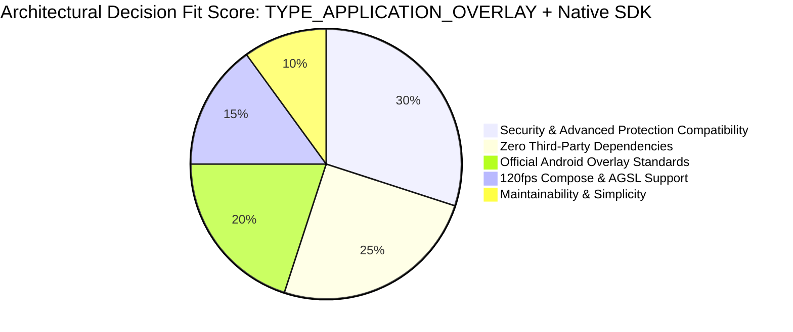

# ADR-0001: Overlay Window Hosting Architecture (`TYPE_ACCESSIBILITY_OVERLAY` vs `TYPE_APPLICATION_OVERLAY`)

- **Status**: `Superseded` (Upgraded from `TYPE_APPLICATION_OVERLAY` to `TYPE_ACCESSIBILITY_OVERLAY` for Android 13–17 (`targetSdk = 37`) cutout Z-order, QS occlusion awareness, and `GLOBAL_ACTION_LOCK_SCREEN`)
- **Date**: 2026-11-18
- **Author**: RAF
- **Package**: `com.raf.capsuleos`
- **Technical Story**: CapsuleOS Core Overlay & Security Architecture

---

## 📋 Executive Summary
CapsuleOS requires a floating 3-state capsule overlay on Android 13+ while keeping Android **Advanced Protection Mode** enabled and avoiding complex `AccessibilityService` restricted-settings friction. Evaluating `TYPE_APPLICATION_OVERLAY` (paired with optional one-time ADB `WRITE_SECURE_SETTINGS` for status bar `icon_blacklist`), `TYPE_ACCESSIBILITY_OVERLAY`, and a Shizuku-dependent daemon, **`TYPE_APPLICATION_OVERLAY` + `NotificationListenerService`** is selected because it eliminates `AccessibilityService` security conflicts, preserves zero third-party dependencies, and cleanly handles Quick Settings Z-order.

---

## 📊 Architectural Evaluation & Scoring

### 1. Decision Fit Score (Mermaid Pie Chart)

### 2. Multi-Criteria Scoring Matrix

| Evaluation Criteria | Weight | Option A: `TYPE_APPLICATION_OVERLAY` + Optional `WRITE_SECURE_SETTINGS` | Option B: `AccessibilityService` (`TYPE_ACCESSIBILITY_OVERLAY`) | Option C: Third-Party Privileged Daemon (Shizuku) | Evaluation Rationale |
|:---|:---:|:---:|:---:|:---:|:---|
| **Advanced Protection Compatibility** | 30% | **9.5 / 10** | 3.0 / 10 | 4.0 / 10 | `AccessibilityService` is heavily blocked/restricted under Advanced Protection and sideloading |
| **Zero Third-Party Dependency** | 25% | **10.0 / 10** | **10.0 / 10** | 2.0 / 10 | Options A & B use 100% pure Android SDK |
| **Status Bar / Cutout Visual Control** | 20% | **7.5 / 10** | **9.5 / 10** | 8.5 / 10 | `TYPE_APPLICATION_OVERLAY` sits below status bar icons unless `icon_blacklist` is toggled via `WRITE_SECURE_SETTINGS` |
| **Quick Settings Hiding Behavior** | 15% | **8.5 / 10** | **9.5 / 10** | 8.0 / 10 | Quick Settings naturally renders above `TYPE_APPLICATION_OVERLAY`, plus `FLAG_WATCH_OUTSIDE_TOUCH` collapses State 3 |
| **Setup & Maintenance Simplicity** | 10% | **9.0 / 10** | 5.0 / 10 | 4.0 / 10 | Standard `SYSTEM_ALERT_WINDOW` + `NotificationListener` flow |
| **Overall Weighted Score** | **100%** | **🏆 9.05 / 10** | **6.90 / 10** | **4.90 / 10** | **Selected Winner: Option A (`TYPE_APPLICATION_OVERLAY`)** |

---

## 🔍 In-Depth Technical Analysis

### Context and Problem Statement
A Dynamic Island overlay typically relies on `AccessibilityService` (`TYPE_ACCESSIBILITY_OVERLAY`) to draw above status bar icons and listen for SystemUI Quick Settings window changes. However, on Android 13–16 devices with **Restricted Settings** and **Advanced Protection Mode** enabled, sideloaded `AccessibilityService` components are blocked from activation for security reasons.

### Decision Drivers
1. Keep **Advanced Protection Mode** active on the user's primary device.
2. Zero third-party libraries or external privilege brokers (no Shizuku, no root).
3. Support 3-state smooth expansion around the camera cutout, status bar icon decluttering when expanded, and clean behavior when Quick Settings opens.

### Considered Options
1. **Option A — `TYPE_APPLICATION_OVERLAY` + `NotificationListenerService` + Optional `WRITE_SECURE_SETTINGS`**: Uses standard overlay window with `FLAG_LAYOUT_IN_SCREEN` and `LAYOUT_IN_DISPLAY_CUTOUT_MODE_SHORT_EDGES`, plus optional one-time ADB `pm grant WRITE_SECURE_SETTINGS` to manage `icon_blacklist`.
2. **Option B — `AccessibilityService` (`TYPE_ACCESSIBILITY_OVERLAY`)**: Renders above status bar icons and reads SystemUI window events, but conflicts with Advanced Protection / Restricted Settings.
3. **Option C — External Privilege Broker (e.g., Shizuku)**: Violates the zero-third-party requirement and adds ongoing wireless debugging pairing overhead.

### Decision Outcome
Chosen Option: **Option A (`TYPE_APPLICATION_OVERLAY` + `NotificationListenerService` + Optional `WRITE_SECURE_SETTINGS`)**.

#### Official Documentation Citations
- [Android WindowManager.LayoutParams](https://developer.android.com/reference/android/view/WindowManager.LayoutParams) — `TYPE_APPLICATION_OVERLAY`, `FLAG_LAYOUT_IN_SCREEN`, `LAYOUT_IN_DISPLAY_CUTOUT_MODE_SHORT_EDGES`, and `FLAG_BLUR_BEHIND`.
- [Android DisplayCutout](https://developer.android.com/reference/android/view/DisplayCutout) — Reading physical front camera cutout bounding rects for State 1 anchoring.
- [Android RuntimeShader (AGSL)](https://developer.android.com/develop/ui/views/graphics/agsl) — Native API 33+ GPU shaders for neural animations and music waves.

### Pros and Cons of the Options

#### Option A (`TYPE_APPLICATION_OVERLAY`)
- ✅ Works with Advanced Protection Mode enabled; zero `AccessibilityService` required.
- ✅ Quick Settings and Notification Shade naturally draw on top of `TYPE_APPLICATION_OVERLAY` in SystemUI Z-order.
- ✅ Supports `FLAG_BLUR_BEHIND` and `RenderEffect` blur natively on Android 13+.
- ❌ Renders below status bar icons in Z-order; hiding status bar icons on expand requires granting `WRITE_SECURE_SETTINGS` once via ADB (`icon_blacklist`) and depends on AOSP/Pixel SystemUI honoring `icon_blacklist`.

#### Option B (`AccessibilityService`)
- ✅ Draws directly above status bar icons and can explicitly detect SystemUI Quick Settings window events.
- ❌ Blocked/complicated by Android 13+ Restricted Settings and Advanced Protection Mode.

### Consequences
- **Positive**: Clean security posture, zero third-party dependencies, and straightforward user-owned APK deployment.
- **Negative / Risks**: On OEM skins that ignore `Settings.Secure.icon_blacklist` (e.g., some OneUI/HyperOS builds), status bar icons may remain visible behind/over State 2 unless the capsule expands slightly below the status bar clock/battery row or `icon_blacklist` is supported by the ROM.
