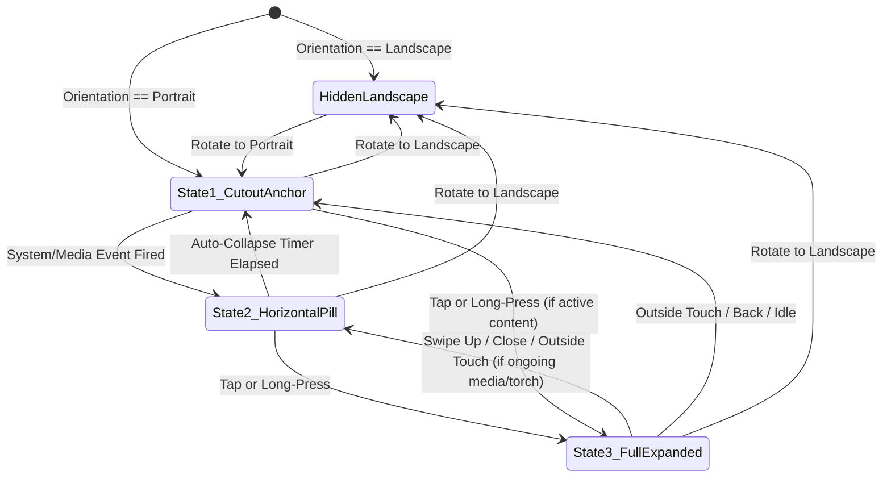
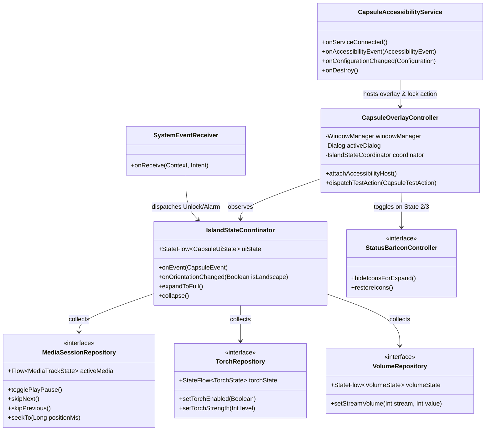
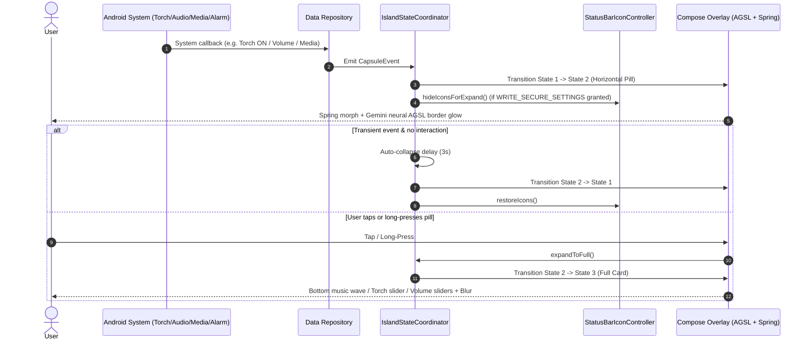

# CapsuleOS (Raf Capsule) — System Architecture & Design Specification

- **Package / Application ID**: `com.raf.capsuleos`
- **Target Platform**: Android (`minSdk = 33` / Android 13+, `compileSdk = 37`, `targetSdk = 37` / **Android 17**)
- **Language & UI**: Kotlin 2.4+, Jetpack Compose + Navigation 3, Material 3 Expressive, AGSL (`RuntimeShader`), Clean Architecture (`:domain`, `:data`, `:presentation`, `:app`)
- **Project Location**: `/Users/raf/Coding/AndroidStudioProjects/CapsuleOS`

---

## 1. Core Design Goals

1. **System-Level Cutout Z-Order & Controls**:
   - Uses `CapsuleAccessibilityService` (`TYPE_ACCESSIBILITY_OVERLAY`) + `CapsuleOverlayController` to render seamlessly above the status bar & camera cutout across apps and invoke `GLOBAL_ACTION_LOCK_SCREEN`, paired with `NotificationListenerService` (for `MediaSessionManager` and notification bridges) and optional one-time ADB `WRITE_SECURE_SETTINGS` for `icon_blacklist` / heads-up popup suppression.
2. **Three-State Dynamic Capsule**:
   - **State 1 (Cutout Anchor)**: Minimal `#000000` 1:1 ring wrapping the auto-detected Left/Center/Right `DisplayCutout` with clockwise AGSL battery ring accent.
   - **State 2 (Horizontal Pill)**: Matte-black asymmetric horizontal pill expanding from the calibrated Left, Center, or Right camera anchor with directional swipe carousel and tap/double-tap/hold/scrub gestures.
   - **State 3 (Full Expanded Card)**: Vertical top-black to bottom-translucent frosted blur card with configurable inner content padding, interactive Media / Notification (quick reply + actions) / Torch / Sound Mixer (with Ring / Vibrate / Silent buttons) / Now Brief / Alarm / Unlock cards.
3. **Butter-Smooth Spring Physics & Native GPU Shaders**:
   - VSYNC-synchronized Compose / Window spring kinematics paired with SharedElement + `SeekableTransitionState` 1:1 finger-tracked vertical scrub morphing.
   - **AGSL `RuntimeShader`** (`minSdk = 33`) for Gemini-style neural dot/border animations and continuous bottom-rising music wave visuals.
   - **Native Blur**: `RenderEffect.createBlurEffect` for album artwork backdrop + `WindowManager.LayoutParams.setBackgroundBlurRadius` for State 3 card depth.
4. **In-App Calibration & Sandbox Simulation (Navigation 3)**:
   - Categorized Setup dashboard (`Setup`, `Camera Position`, `Behavior & Layout`, `Live Overlay Quick Test`) with animated permission dismissal, initial hardware `DisplayCutout` auto-detection + manual Left/Center/Right and precision `-`/`+` sliders, and an isolated in-app **Navigation 3** Simulation screen.

---

## 2. Three-State Machine (`stateDiagram-v2`)



---

## 3. Clean Architecture Class Diagram (`classDiagram`)



---

## 4. Event-to-Expansion Sequence (`sequenceDiagram`)



---

## 5. Use Case Specifications

| Field | Specification |
|---|---|
| **Use Case ID** | `UC-001: Media Playback & Butter-Smooth Expansion` |
| **Primary Actor** | End User |
| **Pre-Conditions** | `SYSTEM_ALERT_WINDOW` and `BIND_NOTIFICATION_LISTENER_SERVICE` granted. |
| **Trigger** | Media session starts playing or changes track. |
| **Main Scenario** | 1. `MediaSessionRepository` emits track metadata + sampled album art color.<br/>2. `IslandStateCoordinator` transitions capsule to **State 2 (Horizontal Pill)**.<br/>3. User taps/long-presses pill ➔ transitions via spring physics to **State 3 (Full Card)**.<br/>4. Bottom AGSL music wave animates with frosted `RenderEffect` blur; user controls play/pause/skip/seek. |
| **Alternative Scenario** | Device rotates to landscape ➔ `IslandStateCoordinator` transitions to `HiddenLandscape` immediately. |
| **Post-Conditions** | Playback state synced; outside tap collapses back to State 2 or State 1. |

| Field | Specification |
|---|---|
| **Use Case ID** | `UC-002: Flashlight Toggle & Strength Control` |
| **Primary Actor** | End User |
| **Pre-Conditions** | Camera flash hardware present (Android 13+ API 33+). |
| **Trigger** | Flashlight turned ON via Quick Settings or system gesture. |
| **Main Scenario** | 1. `CameraManager.TorchCallback` fires `onTorchModeChanged(true)`.<br/>2. Capsule expands to **State 2** with animated torch icon + neural border pulse.<br/>3. User taps pill ➔ **State 3** opens with brightness slider (`turnOnTorchWithStrengthLevel`) and quick OFF button. |
| **Alternative Scenario** | Hardware supports only binary torch (`maxLevel == 1`) ➔ State 3 shows quick ON/OFF toggle instead of slider. |
| **Post-Conditions** | Torch state reflected accurately in real time. |

| Field | Specification |
|---|---|
| **Use Case ID** | `UC-003: Volume, Unlock & Alarm Triggers` |
| **Primary Actor** | End User |
| **Pre-Conditions** | Overlay service running in foreground. |
| **Trigger** | Volume button pressed, screen unlocked (`ACTION_USER_PRESENT`), or next alarm changed (`ACTION_NEXT_ALARM_CLOCK_CHANGED`). |
| **Main Scenario** | 1. Observer dispatches transient `CapsuleEvent`.<br/>2. Capsule animates to **State 2** with animated icon.<br/>3. If untapped, auto-collapses to **State 1** after 2.5–3.5s.<br/>4. If tapped (e.g., Volume), expands to **State 3** with Media/Ring/Alarm sliders. |
| **Post-Conditions** | Status bar `icon_blacklist` restored on return to State 1. |

---

## 6. Multi-Module Package Structure (`com.raf.capsuleos`)

```text
CapsuleOS/
├── app/src/main/kotlin/com/raf/capsuleos/
│   ├── CapsuleApplication.kt
│   └── MainActivity.kt               # Edge-to-edge host rendering CapsuleNavHost (Navigation 3)
├── domain/src/main/kotlin/com/raf/capsuleos/domain/
│   ├── model/                        # CapsuleUiState, CapsulePreferences, CapsuleContent, CapsuleEvent
│   ├── repository/                   # Pure Kotlin repository interfaces (Torch, Volume, Brightness, Media, Notif, Settings)
│   └── coordinator/                  # IslandStateCoordinator (priority stack, timers, scrub targets, carousel)
├── data/src/main/kotlin/com/raf/capsuleos/data/
│   ├── di/                           # DataModule (Hilt bindings)
│   ├── media/                        # CapsuleNotificationListenerService, MediaSessionRepositoryImpl, BitmapColorExtractor
│   ├── hardware/                     # BrightnessRepositoryImpl (API 37 percentage), TorchRepositoryImpl, VolumeRepositoryImpl
│   ├── notification/                 # NotificationRepositoryImpl
│   ├── settings/                     # CapsuleSettingsRepositoryImpl (DataStore Preferences)
│   ├── statusbar/                    # StatusBarIconControllerImpl (WRITE_SECURE_SETTINGS icon_blacklist & heads-up)
│   └── system/                       # SystemEventsRepositoryImpl (Battery, Screen/Unlock, Alarm, Weather)
└── presentation/src/main/kotlin/com/raf/capsuleos/presentation/
    ├── navigation/                   # CapsuleRoute, CapsuleNavHost (Navigation 3)
    ├── capsule/
    │   ├── service/                  # CapsuleAccessibilityService, CapsuleOverlayController, CutoutGeometryResolver
    │   ├── shader/                   # NeuralBorderShader.kt (AGSL), MusicWaveShader.kt (AGSL)
    │   └── ui/                       # IslandCapsule.kt, State2HorizontalPill.kt, State3ExpandedCard.kt + expanded cards
    ├── setup/                        # SetupScreen, SetupContent, SetupViewModel, categorized setup/tuning cards
    ├── simulation/                   # SimulationScreen, SimulationContent, SimulationViewModel (sandbox IslandStateCoordinator)
    └── common/                       # CapsuleSlider (SegmentFrequentTick haptics), CapsuleExpressive, CapsuleHaptics
```

### Delivery Phases (`compileSdk = 37`, `targetSdk = 37` / Android 17)
- **Phase 1**: Multi-module Hilt + Clean Architecture (`minSdk = 33`, `targetSdk = 37`), `CapsuleAccessibilityService` overlay host, auto-detected Left/Center/Right cutout geometry, and Setup dashboard.
- **Phase 2**: `IslandStateCoordinator` + 3-state `spring()` morphing capsule + AGSL Gemini-style neural dot/border shader + 1:1 vertical scrub.
- **Phase 3**: `NotificationListenerService` + `MediaSessionManager` + State 3 Media (`Cookie7Sided` play/pause + AGSL wave), Notifications (inline actions & priority), and Quick Hub (`Now Brief`).
- **Phase 4**: Hardware & System controls (Flashlight %, Sound Mixer + Ring/Vibrate/Silent buttons, API 37 Brightness sync, Alarm/Unlock) + Navigation 3 Interactive Sandbox Simulation screen.
