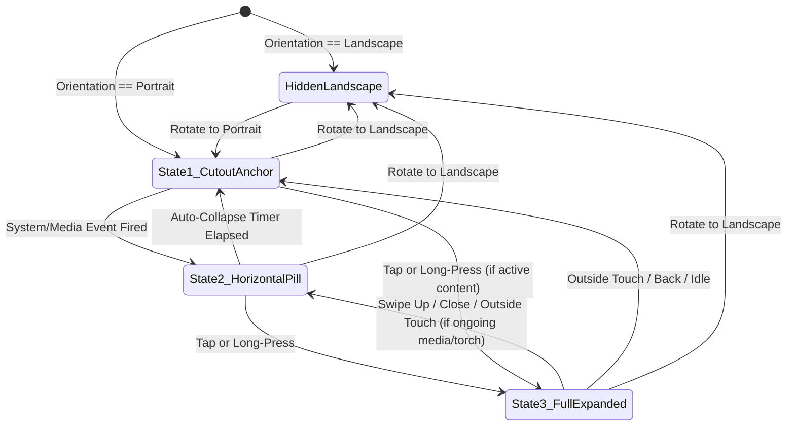
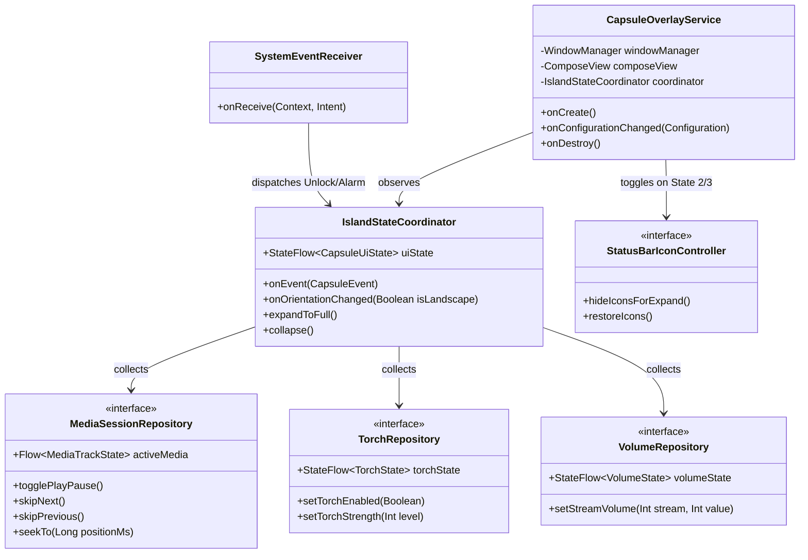
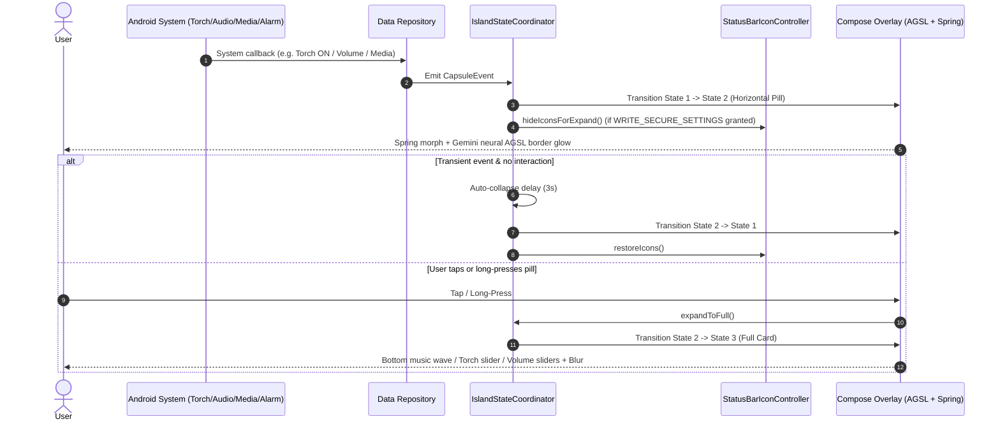

# CapsuleOS — System Architecture & Design Specification

- **Target Platform**: Android (`minSdk = 33` / Android 13+, `targetSdk = 35/36`)
- **Language & UI**: Kotlin 2.x+, Jetpack Compose, AGSL (`RuntimeShader`), Clean Architecture (MVVM + MVI State Coordinator)
- **External Dependencies**: Zero third-party runtime dependencies (100% Android SDK & Jetpack)
- **Project Location**: `/Users/raf/Coding/AndroidStudioProjects/CapsuleOS`

---

## 1. Core Design Goals

1. **Full User Control & Security Compatibility**:
   - No `AccessibilityService` required — compatible with Android **Advanced Protection Mode** enabled.
   - Uses `TYPE_APPLICATION_OVERLAY` (`SYSTEM_ALERT_WINDOW`), `NotificationListenerService` (for `MediaSessionManager`), and optional one-time ADB `WRITE_SECURE_SETTINGS` grant for status bar icon hiding (`icon_blacklist`).
2. **Three-State Dynamic Capsule**:
   - **State 1 (Cutout Anchor)**: Minimal `#000000` wrap around the front camera `DisplayCutout` with subtle ambient indicator.
   - **State 2 (Horizontal Pill)**: Expands horizontally along the top bar when live data or system events fire; hides status bar system icons via `icon_blacklist` (when permitted) and auto-collapses transient events back to State 1.
   - **State 3 (Full Expanded Card)**: Expands downward on tap or long-press with rich interactive controls (Media player, Torch brightness slider, Volume mixer, Alarm/Unlock info).
3. **120fps Butter-Smooth Physics & Native GPU Effects**:
   - Zero `WindowManager.updateViewLayout()` calls during frame animation; morphing runs entirely inside Compose `spring()` + `graphicsLayer`.
   - **AGSL `RuntimeShader`** (`minSdk = 33`) for Gemini-style neural dot/border animations and bottom-rising music wave visuals.
   - **Native Blur**: `RenderEffect.createBlurEffect` for internal frosted ambient glow + `WindowManager.LayoutParams.FLAG_BLUR_BEHIND` (gated by `isCrossWindowBlurEnabled`) for State 3 depth.
4. **Contextual Auto-Hide**:
   - Automatically hides in **Landscape** (`Configuration.ORIENTATION_LANDSCAPE` + `DisplayListener`).
   - Quick Settings / Notification Shade naturally draws **above** `TYPE_APPLICATION_OVERLAY` in SystemUI Z-order, while `FLAG_WATCH_OUTSIDE_TOUCH` collapses expanded State 3 on outside touch.

---

## 2. Three-State Machine (`stateDiagram-v2`)



---

## 3. Clean Architecture Class Diagram (`classDiagram`)



---

## 4. Event-to-Expansion Sequence (`sequenceDiagram`)



---

## 5. Use Case Specifications

| Field | Specification |
|---|---|
| **Use Case ID** | `UC-001: Media Playback & Butter-Smooth Expansion` |
| **Primary Actor** | End User |
| **Pre-Conditions** | `SYSTEM_ALERT_WINDOW` and `BIND_NOTIFICATION_LISTENER_SERVICE` granted. |
| **Trigger** | Media session starts playing or changes track. |
| **Main Scenario** | 1. `MediaSessionRepository` emits track metadata + sampled album art color.<br/>2. `IslandStateCoordinator` transitions capsule to **State 2 (Horizontal Pill)**.<br/>3. User taps/long-presses pill ➔ transitions via spring physics to **State 3 (Full Card)**.<br/>4. Bottom AGSL music wave animates with frosted `RenderEffect` blur; user controls play/pause/skip/seek. |
| **Alternative Scenario** | Device rotates to landscape ➔ `IslandStateCoordinator` transitions to `HiddenLandscape` immediately. |
| **Post-Conditions** | Playback state synced; outside tap collapses back to State 2 or State 1. |

| Field | Specification |
|---|---|
| **Use Case ID** | `UC-002: Flashlight Toggle & Strength Control` |
| **Primary Actor** | End User |
| **Pre-Conditions** | Camera flash hardware present (Android 13+ API 33+). |
| **Trigger** | Flashlight turned ON via Quick Settings or system gesture. |
| **Main Scenario** | 1. `CameraManager.TorchCallback` fires `onTorchModeChanged(true)`.<br/>2. Capsule expands to **State 2** with animated torch icon + neural border pulse.<br/>3. User taps pill ➔ **State 3** opens with brightness slider (`turnOnTorchWithStrengthLevel`) and quick OFF button. |
| **Alternative Scenario** | Hardware supports only binary torch (`maxLevel == 1`) ➔ State 3 shows quick ON/OFF toggle instead of slider. |
| **Post-Conditions** | Torch state reflected accurately in real time. |

| Field | Specification |
|---|---|
| **Use Case ID** | `UC-003: Volume, Unlock & Alarm Triggers` |
| **Primary Actor** | End User |
| **Pre-Conditions** | Overlay service running in foreground. |
| **Trigger** | Volume button pressed, screen unlocked (`ACTION_USER_PRESENT`), or next alarm changed (`ACTION_NEXT_ALARM_CLOCK_CHANGED`). |
| **Main Scenario** | 1. Observer dispatches transient `CapsuleEvent`.<br/>2. Capsule animates to **State 2** with animated icon.<br/>3. If untapped, auto-collapses to **State 1** after 2.5–3.5s.<br/>4. If tapped (e.g., Volume), expands to **State 3** with Media/Ring/Alarm sliders. |
| **Post-Conditions** | Status bar `icon_blacklist` restored on return to State 1. |

---

## 6. Package Structure & Implementation Roadmap

```text
app/src/main/java/com/capsule/os/
├── domain/
│   ├── model/          # CapsuleUiState, CapsuleContent, NeuralEffectConfig
│   └── coordinator/    # IslandStateCoordinator (priority queue, timers, orientation gate)
├── data/
│   ├── media/          # CapsuleNotificationListener, MediaSessionRepository, BitmapColorExtractor
│   ├── hardware/       # TorchRepository, VolumeRepository
│   ├── system/         # SystemEventReceiver (USER_PRESENT, NEXT_ALARM_CLOCK_CHANGED)
│   └── statusbar/      # StatusBarIconController (WRITE_SECURE_SETTINGS icon_blacklist)
└── presentation/
    ├── service/        # CapsuleOverlayService (LifecycleOwner + SavedStateRegistryOwner + ComposeView)
    ├── shader/         # NeuralBorderShader.kt (AGSL), MusicWaveShader.kt (AGSL)
    └── ui/             # IslandCapsule.kt, State1Cutout.kt, State2HorizontalPill.kt, State3ExpandedCard.kt
```

### Delivery Phases
- **Phase 1**: Gradle scaffold (`minSdk = 33`), `CapsuleOverlayService` lifecycle host, cutout coordinate detection, landscape auto-hide, and setup/permissions onboarding Activity.
- **Phase 2**: `IslandStateCoordinator` + 3-state `spring()` morphing capsule + AGSL Gemini-style neural dot/border shader.
- **Phase 3**: `NotificationListenerService` + `MediaSessionManager` + State 3 Media Card (bottom AGSL wave + `RenderEffect` blur + seek/transport).
- **Phase 4**: Hardware & System Event triggers (Torch strength slider, Volume multi-stream mixer, Unlock greeting, Alarm indicator) + `StatusBarIconController`.
